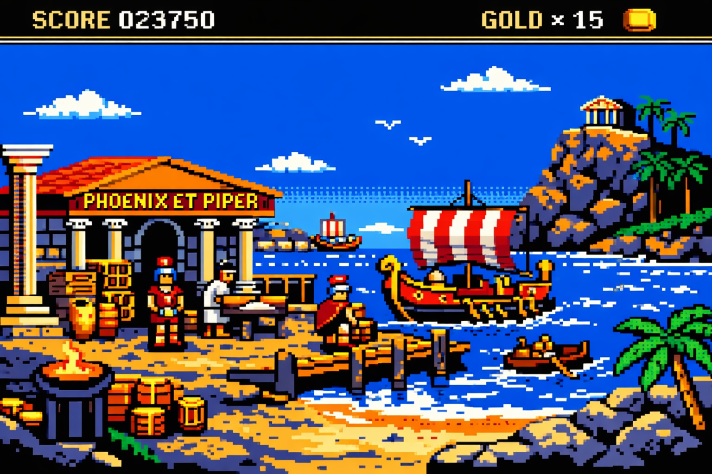
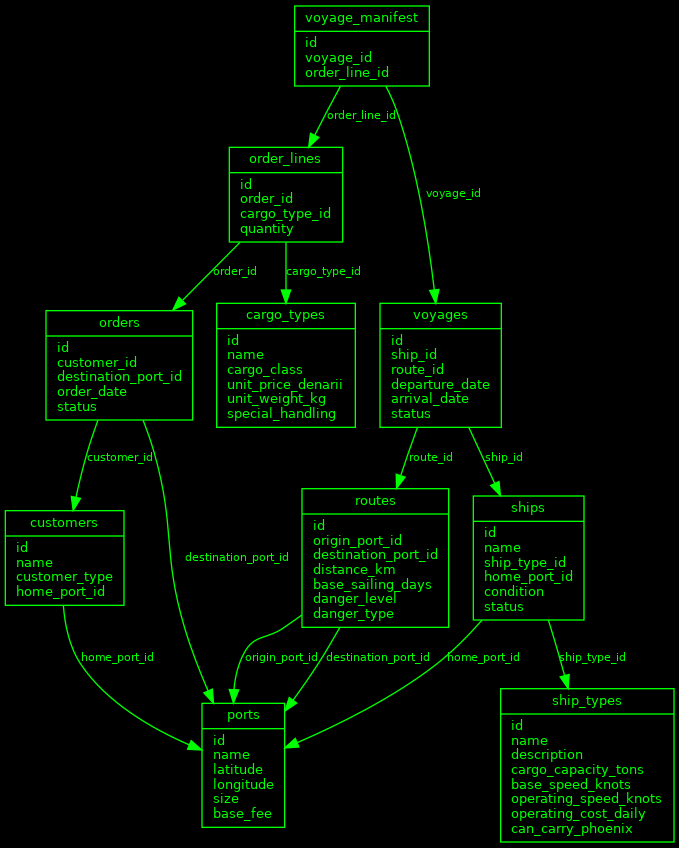
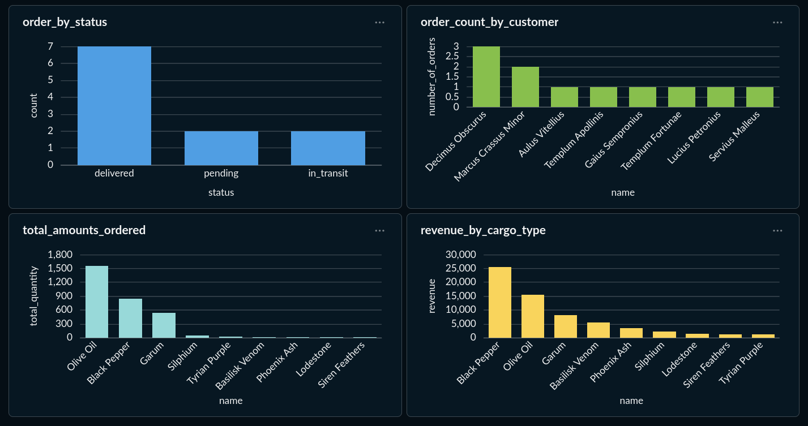
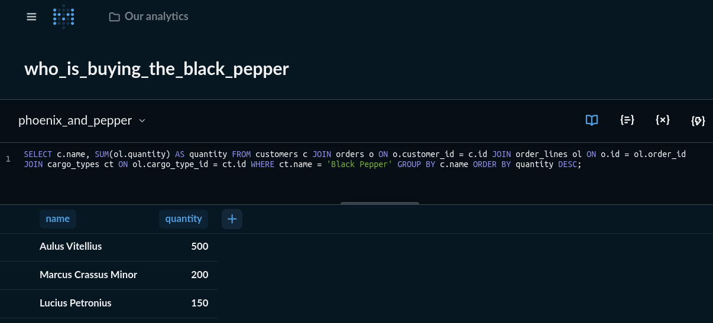

Hey y'all, or as the Romans would say, salvete omnes!

For learning and for fun, I started a fake Roman trading company. It's called Phoenix and Pepper (Latin: Phoenix et Piper) and it operates in a world where the classical sources are literally true. Pliny's Natural History is a field manual. Ovid's Metamorphoses is recent history. The gods intervene. The monsters are real :O

The idea is to simulate a complete business from scratch, using stuff that's fun enough to keep me going when the debugging gets tedious and the coffee gets low. Instead of yet another e-commerce tutorial with bland sample data, I've got two business partners in Ostia trying to ship basilisk venom past Scylla and Charybdis while keeping the garum fresh. (Garum is a sauce made of icky fish guts, but the Romans loved it! Well most of them did. Pliny the Elder disapproved.)

The company has two cargo classes. Phoenix-class is the rare, dangerous, mythological stuff — phoenix ash, basilisk venom, siren feathers. High margin, high risk, needs a priest of Apollo to bless the containers. Pepper-class is the everyday bulk trade — black pepper, garum, olive oil, Tyrian purple. Predictable demand, tight margins, lots of it. The entire business is about managing the tradeoffs between these two sides in a world where an octopus might be stealing the olives at midnight.

This post is about the first stretch: building the foundation. By the end I had a Postgres database, synthetic data, a test suite, a CI/CD pipeline, and the first dashboard. It took me about two days.

The company starts small: a warehouse in Ostia, three ships, a handful of routes along the Italian coast. Eight ports from Ostia down to Sicily. Three types of ships — the Corbita (slow, big, cheap, hauls pepper), the Actuaria (fast, small, expensive, the only one rated for Phoenix-class cargo), and the Ponto (somewhere in between, pleases nobody fully, like most compromises).

For the tech stack, I wanted tools I could grow into. PostgreSQL for the database, running in a Podman container. SQLAlchemy for defining the schema in Python. pytest for testing everything. GitHub Actions for CI/CD. uv for managing the Python project. And Metabase for dashboards — also in a container, one podman-compose up and the whole thing is running.

Here's how the whole world fits together — ten tables, lots of foreign keys, and one suspicious customer we'll get to shortly:

The schema is nice, but empty tables don't tell you much. I needed to populate the world with ports, ships, cargo, customers, and orders — synthetic data that feels plausible enough to ask interesting questions about.

I put the data in JSONL files — one per table, one record per line — and wrote a Python script that loads them into Postgres in foreign key order. Ports first (nothing depends on nothing), then routes (which need ports to exist), then ships (which need ports and ship types), and so on down the chain until the last table: the voyage manifest, which connects everything.

I included eight ports along the Italian coast, from Ostia down to Sicily. Three ships with proper Latin names — the Ignis Maris, the Fortuna Lenta, the Ventus Secundus. Nine types of cargo, from olive oil to siren feathers. And eight customers: merchants, temples, provincial officials, and one magus named Decimus Obscurus who operates out of Panormus — the smallest, quietest port. Decimus only ever orders Phoenix-class goods in small quantities to different destinations. He doesn't ask many questions. Nobody asks him many questions either.

Forty-nine tests confirm that all of this stuff hangs together! Every loader, every foreign key, every business rule.

With the data loaded, I pointed Metabase at the database and started asking questions. Metabase runs in its own container alongside Postgres — same podman-compose up, and I've got a BI tool at localhost:3000.

The first thing I learned: Pepper-class dominates by volume. Almost 900 units of black pepper alone. But when you multiply quantity by unit price, the picture shifts. Basilisk venom — just a few units — generates almost as much revenue as all that garum. That's the whole premise of the business in one chart.

I wondered who was buying all that black pepper so...

Aulus Vitellius is a provincial official based in Tarentum, so he's provisioning hard to feed his peoples!

The whole project lives in a [public GitHub repo](https://github.com/estimatrixPipiatrix/phoenix-and-pepper.git). If you want to poke around, it's all there — the schema, the data, the tests, the Latin documentation (yes, Latin).

As for what's next: The trade network is begging for graph analysis, Neptune is reportedly unhappy about something, and Decimus Obscurus is still out there placing his strange little orders. We'll see!
