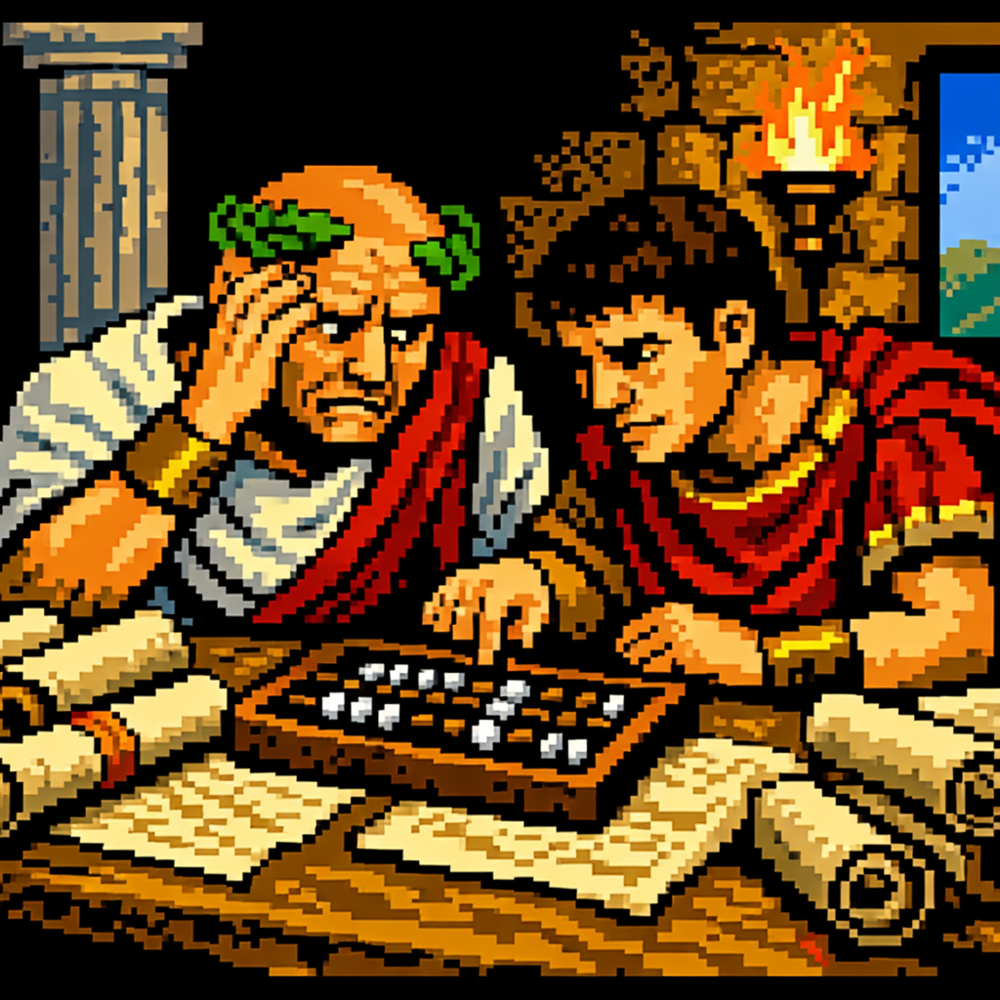
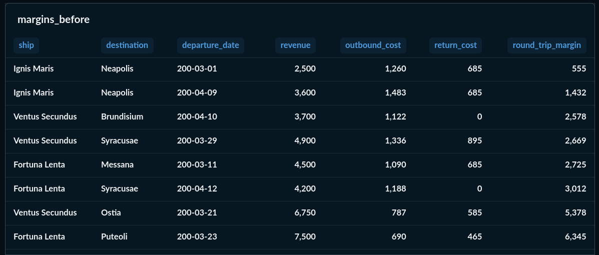
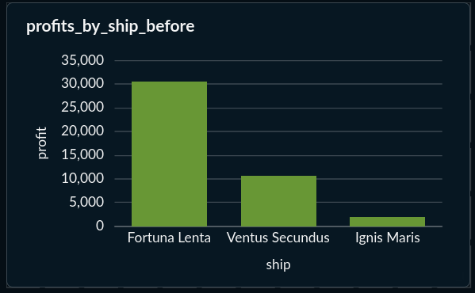
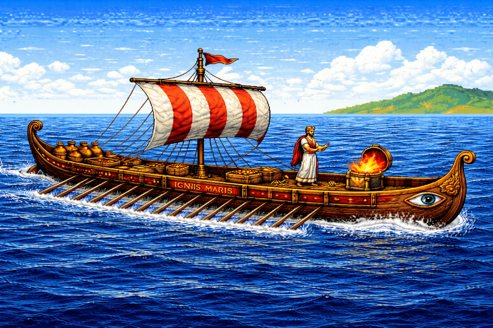
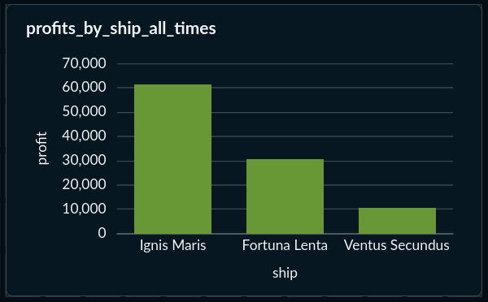

Title: Revenue isn't profit (the Ignis Maris learns a lesson)
Date: 2026-04-05
Category: business intelligence
Tags: metabase, SQL, cost modeling
Slug: revenue-isnt-profit
Authors: Kayla Lewis
Summary: the partners discover that their most impressive ship is also their least profitable — and then they fix it

Hey y'all! Last time we built Phoenix and Pepper from scratch — a Postgres database, synthetic data, a test suite, a CI/CD pipeline, and a Metabase dashboard. We ended on a high note: basilisk venom generates huge revenue per unit, black pepper moves in bulk, and the business looks healthy.

But there was a problem hiding in the numbers. We were looking at revenue. We weren't looking at costs.

## The moment of doubt

Here's what we knew from the first dashboard: Phoenix-class goods have eye-popping unit prices. A single vial of basilisk venom is worth 800 denarii. Five units of phoenix ash: 2,500 denarii. But as we saw last time, total revenue tells a different story — black pepper and olive oil dominate because the volumes are so much larger. Basilisk venom, at just a few units, lands somewhere around garum. Impressive per vial, modest in aggregate.

So Phoenix goods weren't even the revenue leaders. And we were about to discover they were also the most expensive to move.

A ship doesn't sail for free. The Ignis Maris — our Actuaria, the only ship rated for Phoenix-class cargo — costs 120 denarii a day to operate and 80 denarii a day in crew wages. That's 200 denarii a day, every day it's at sea. The Fortuna Lenta, our big slow Corbita, costs only 120 a day total. And every voyage has two legs: out with cargo, back with nothing.

We needed a cost model.

## Building the cost model

I added two new columns to existing tables and one entirely new table.

On `ship_types`, a new `crew_cost_daily` field. The Actuaria's rowers are expensive — 80 denarii a day compared to 40 for the Corbita's sailors. On `cargo_types`, a `handling_cost_per_unit` for Phoenix-class goods. The priest of Apollo who blesses the phoenix ash containers doesn't work for free (100 denarii per unit). Lead-sealing amphorae of basilisk venom so nobody makes eye contact with the cargo? 150 per unit. Wax-sealing chests of siren feathers while the crew wears earplugs? 120.

Pepper-class goods have zero handling cost. You just load them on.

Then a new `voyage_costs` table with six columns breaking out every voyage's costs:

- **Ship operations** — the ship type's daily operating cost times the number of sailing days
- **Port fees** — base fee at origin plus base fee at destination
- **Crew wages** — daily crew cost times sailing days
- **Phoenix handling** — handling cost per unit times quantity, for every Phoenix-class item on the manifest
- **Hazard surcharge** — 3% of the total cargo value times the route's danger level, representing offerings to Neptune, crew hazard pay, and what the Romans probably would have called insurance
- **Total cost** — the sum of everything above

One new model class in SQLAlchemy, one new JSONL file, one new loader, and a handful of updated tests. The same pattern as everything else in the project.

## What the numbers said

The numbers told a story we didn't expect.

The Fortuna Lenta hauling pepper and olive oil to Tarentum? 21,000 denarii in revenue, and even after the return leg, the round-trip margin was 87.5%. The big, slow, boring ship carrying the most boring cargo on a safe route was our best voyage by a mile.

The Ignis Maris delivering 5 units of phoenix ash to Neapolis? 2,500 denarii in revenue, but 1,260 in outbound costs (operating, crew, port fees, the priest, the hazard premium), plus 685 more to sail home empty. Round-trip margin: only 22.2%.

The return legs were the hidden killer. Every outbound voyage has a shadow cost: the ship sailing back with nothing on board, still burning crew wages and operating costs every day. The Fortuna Lenta's return from Messana cost 685 denarii. The Ignis Maris's return from Neapolis: also 685. Same cost, but the Fortuna Lenta had 4,500 in revenue to absorb it. The Ignis Maris had 2,500.

The Ignis Maris was dead last.

## The problem wasn't Phoenix — it was capacity

It would have been easy to look at these numbers and conclude: stop carrying Phoenix-class goods. Stick to pepper.

But that would miss the real lesson. The Ignis Maris has 40 tons of cargo capacity. That phoenix ash shipment weighed 2.5 kilograms. The ship was 0.006% full. We were paying 200 denarii a day to move a package that would fit in a satchel.

The problem wasn't that Phoenix cargo is unprofitable. The problem was that we were sailing an expensive ship nearly empty. The operating costs and crew wages are fixed — they're the same whether the hold is full or not. Once the Ignis Maris is committed to a voyage for Phoenix cargo, every kilogram of pepper we add to the hold is almost pure profit.

Phoenix-class goods are also what make Phoenix and Pepper different from every other trading company. Anyone can haul pepper. Very few people have an Actuaria with a priest of Apollo on retainer. The Phoenix side of the business is a competitive moat — it just requires the operational discipline to fill the hold every time the ship sails.

## Three new customers, three new voyages

We went looking for bigger Phoenix orders and found three new customers:

**Castra Legionis III** — a legionary camp near Brundisium. The legion needs lodestones for navigation instruments, basilisk venom for weapon coating, and phoenix ash for field rituals. They order in bulk and pay on time.

**Gaius Aurelius Magnificus** — an absurdly wealthy senator in Puteoli building a "Museum of Wonders" at his villa. Phoenix ash for an eternal flame, siren feathers for display cases, basilisk venom for... honestly, nobody asked him why.

**Collegium Magorum Neapolitanum** — a guild of practicing magi in Neapolis. Regular orders for all four Phoenix-class goods: siren feathers for enchantments, basilisk venom for alchemy, lodestones for divination, phoenix ash for purification rites.

And we loaded pepper alongside every Phoenix shipment. The senator's museum order sailed with 200 units of black pepper and 30 units of Tyrian purple for Marcus Crassus Minor. The collegium's order sailed with 150 units of pepper and 100 units of garum for Templum Apollinis. The legion's order sailed with 300 units of pepper and 200 units of olive oil for Gaius Sempronius.

## What the numbers said now

The senator's museum run: 25,300 denarii in revenue, 77.8% round-trip margin. 

The collegium run: 21,100 denarii, 77.0%. 

The legion run to Brundisium: 32,000 denarii at 73% — a bit lower because of that positioning leg, but still a world apart from 22%.

The Ignis Maris went from the least profitable ship in the fleet to the most profitable — by about twice the Fortuna Lenta's total. Not because we abandoned Phoenix cargo, but because we learned how to use it. Phoenix pays for the voyage. Pepper pays for the profit.

## What we learned

Revenue isn't profit. A ship that generates impressive revenue per unit can still be a money pit if it sails with empty hold space. Fixed costs — operating expenses, crew wages — are the same whether the ship is full or empty. The marginal cost of adding pepper to an already-sailing Actuaria is almost nothing.

The cost model also gave us vocabulary for questions we couldn't ask before. "Which voyages are profitable?" is a different question from "which voyages generate the most revenue?" and sometimes the answers are opposites.

Looking ahead: that positioning leg to Puteoli (705 denarii to move an empty ship) is the kind of inefficiency that graph-based route optimization could eliminate. The trade network is growing, the questions are getting harder, and Neptune is reportedly still unhappy about something. We'll see.

The project lives in a [public GitHub repo](https://github.com/estimatrixPipiatrix/phoenix-and-pepper.git) — the schema, the data, the cost model, the tests, the whole enchilada. Or as the Romans might say, ab ovo usque ad malum, from the egg to the apple!
